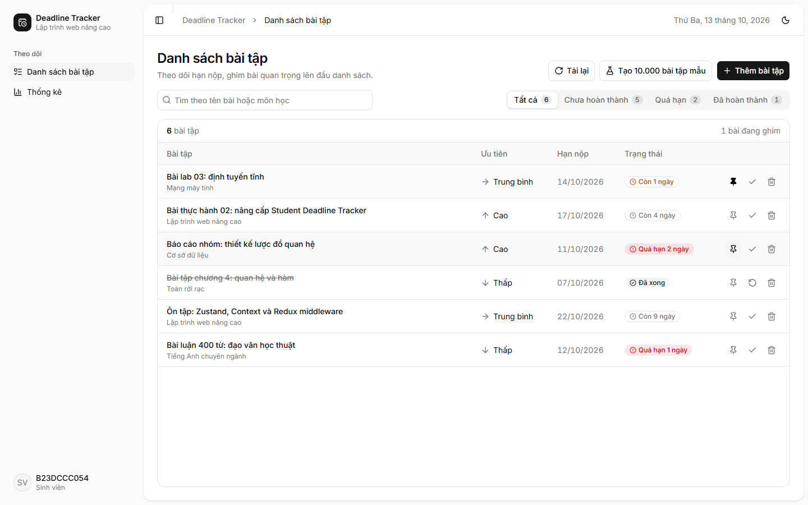
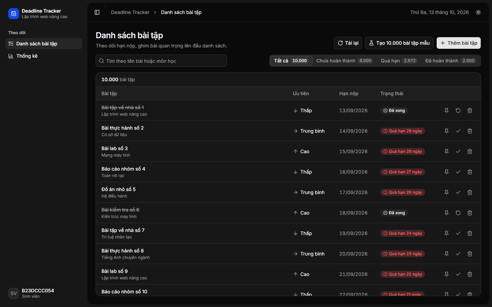
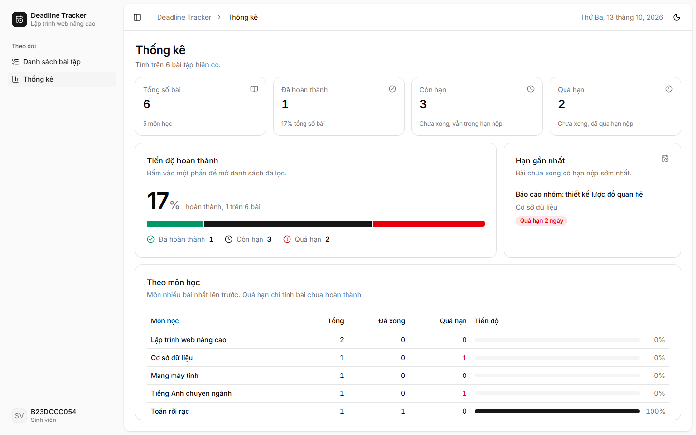
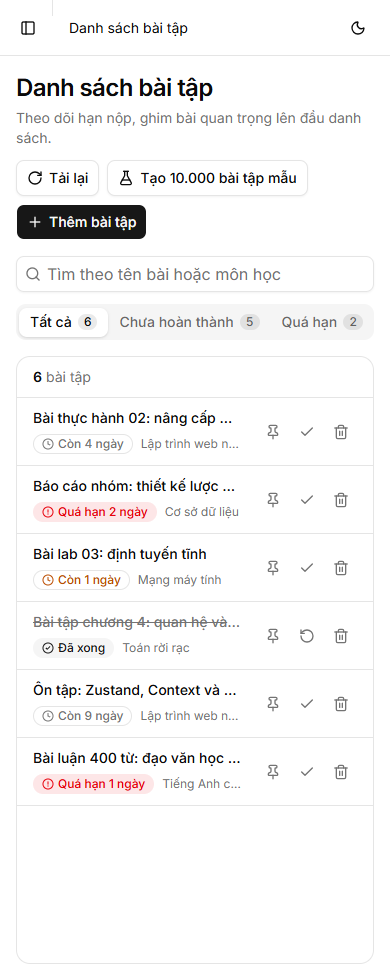

# Deadline Tracker — Bài thực hành 02 (B23DCCC054)

Nâng cấp Student Deadline Tracker của bài thực hành 01 (clone từ `B23DCCC054_LTWNC_TH01`, commit `1392ba5`):

- **Phần A**: ghim bài bằng Zustand, theme sáng/tối bằng Context riêng, `redux-logger` chỉ ở development.
- **Phần B**: chế độ stress test 10.000 bài; `React.memo` + `useCallback`, `useDebounce` + `useMemo`, virtualization bằng `react-window`, `React.lazy` + `Suspense` cho trang Thống kê.
- **Phần C**: Jest + ts-jest + React Testing Library, 64 test, coverage `src/features` 94,9% statements.
- Giao diện dùng **shadcn/ui** với theme mặc định (neutral, font Inter) và bố cục ứng dụng: Sidebar điều hướng, header có breadcrumb, bảng bài tập theo mẫu Tasks, trang Thống kê dạng dashboard.

Báo cáo, số liệu đo và danh sách ảnh cần chụp: [BAO_CAO.md](BAO_CAO.md). Report Lighthouse, kết quả Profiler và script đo ở `reports/`.

| Danh sách (sáng) | 10.000 bài (tối) |
| --- | --- |
|  |  |
| **Thống kê** | **Mobile** |
|  |  |

## Chạy

```bash
npm install
npm run dev          # http://localhost:5173 — bản đã tối ưu
npm test             # Jest + coverage, fail nếu src/features < 70% statements
```

Chế độ stress test: bấm **Tạo 10.000 bài tập mẫu**, hoặc mở thẳng `http://localhost:5173/?stress`
(`?stress=N` để chọn số bài). Lighthouse tải lại trang trước khi đo nên cần dùng URL này.

## Bản trước tối ưu

`src/before/` giữ bản chưa áp dụng bốn kỹ thuật của Phần B, dùng để đo so sánh. Vite chọn bản theo `--mode`:
`--mode before` trỏ `@/App` sang `src/before/App.tsx` (xem `vite.config.ts`). Phần còn lại của app dùng chung.

| Lệnh | Việc |
| --- | --- |
| `npm run dev` / `npm run dev:before` | Dev server bản sau (5173) / bản trước (5174), chạy song song được |
| `npm run build` / `npm run build:before` | Kiểm tra kiểu (app, test, config) rồi build vào `dist/` / `dist-before/` |
| `npm run preview` / `npm run preview:before` | Phục vụ bản build ở 4173 / 4174 — dùng cho Lighthouse |
| `npm test` | Toàn bộ test kèm coverage |
| `npm run test:watch` | Chạy lại test khi sửa file |

Profiler cần bản dev (`npm run dev`, `npm run dev:before`). Lighthouse cần bản build (`preview`), không đo trên dev server.

## Cấu trúc

```
src/
  app/                store (redux-logger chỉ khi development), typed hooks
  components/ui/      component shadcn/ui, sinh bằng `npx shadcn@latest add <tên>`
  components/layout/  khung ứng dụng: AppSidebar (điều hướng), AppHeader (breadcrumb, nút đổi theme)
  features/
    assignments/      slice, API giả lập, danh sách ảo hoá, thẻ bài, form, tiện ích hạn nộp và thống kê, dữ liệu stress
    pins/             usePinStore (Zustand)
    stats/            trang Thống kê (React.lazy)
    theme/            ThemeContext, nút đổi theme
  shared/hooks/       useDebounce, useMediaQuery, useForm
  before/             bản trước tối ưu (chỉ build khi --mode before)
  test/               cấu hình Jest, renderWithProviders, dữ liệu mẫu cho test
```

## shadcn/ui

`components.json` dùng style `radix-vega`, base color `neutral`, icon `lucide`. `src/index.css` giữ nguyên theme mặc định
của shadcn (sáng và `.dark`), font Inter. Component dùng: sidebar, sheet, breadcrumb, card, table, tabs, badge, dialog, field,
input-group, native-select, empty, skeleton, progress, tooltip, avatar. Thêm component: `npx shadcn@latest add <tên>`.
